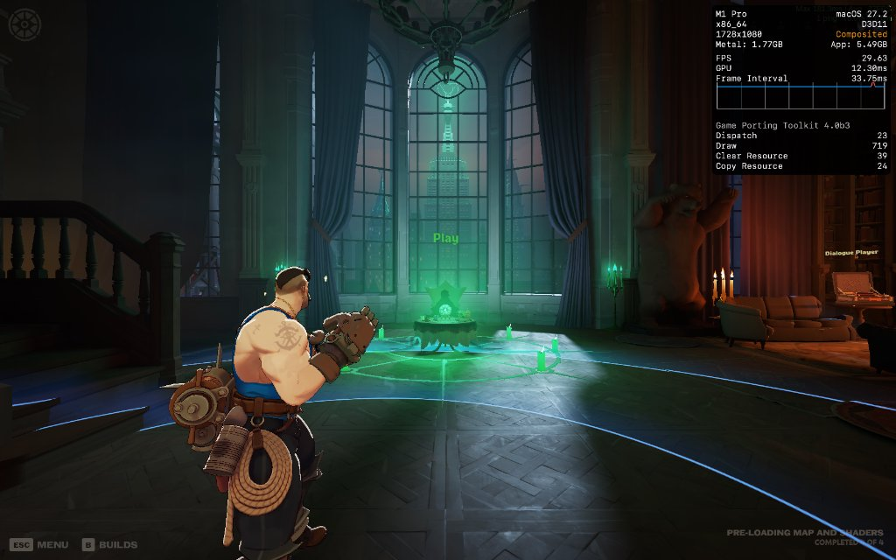

<div align="center">

  # notproton-fpslimit

  **Hardware-Paced Metal Frame Rate Limiter for NotProton & macOS Wine**

  [](https://developer.apple.com/metal/)
  [-lightgrey.svg?style=flat-square)](https://www.apple.com/macos/)
  [](https://www.apple.com/mac/)
  [](https://github.com/NotProtonNot/NotProton)
  [](LICENSE)
  [](https://github.com/Ghostkwebb/notproton-fpslimit/releases/latest)

  <p>
    <b>notproton-fpslimit</b> is a lightweight, universal frame pacing plugin for <b>NotProton</b>.
    <br>
    It eliminates micro-stutter and delivers ruler-flat frametimes in DirectX & Vulkan games running on macOS via <b>D3DMetal</b>, <b>DXMT</b>, and <b>DXVK</b>.
  </p>

  <a href="https://github.com/Ghostkwebb/notproton-fpslimit/releases/latest/download/notproton-fpslimit.zip">
    
  </a>

</div>

<br />

<div align="center">
  
  <p><i>Deadlock (DirectX 11 via D3DMetal) locked at 30 FPS on a 120Hz ProMotion display — ruler-flat 33.75ms frametime line on the Metal HUD.</i></p>
</div>

<br />

> [!IMPORTANT]
> **Compatibility**: Requires **macOS 14.0+** and [NotProton](https://github.com/NotProtonNot/NotProton). Built as a native universal fat binary supporting both **Apple Silicon (M1/M2/M3/M4)** and **Intel** Macs.

---

## ✨ Features

*   🎯 **Ruler-Flat Frametimes**: Meters frame submission intervals and paces CoreAnimation presentation to eliminate judder and uneven display pulldown.
*   ⚡ **Zero-Jitter Hybrid Pacing**: Combines high-resolution kernel waits (`mach_wait_until`) with microsecond spin-yields (`CPU_YIELD`) on `QOS_CLASS_USER_INTERACTIVE` threads.
*   📐 **Bresenham Remainder Tracking**: Accumulates fractional nanosecond clock remainders across frames to guarantee zero drift over multi-hour gaming sessions.
*   🎛️ **Native Steam UI Integration**: Adds a clean slider directly into your game's **Properties $\to$ Compatibility** tab in Steam (snapping to `Off`, `30`, `40`, `60`, `120`, and `144` FPS).
*   🔄 **Optional VSync Decoupling**: Includes an optional sub-toggle to disable VSync quantization when unconstrained presentation is preferred.
*   🪶 **Zero Dependencies**: Pure C/Objective-C linking directly against system Metal and QuartzCore frameworks — zero overhead, no external dependencies.

---

## 🔍 Why This Is Needed

When running Windows games on macOS through translation layers (such as D3DMetal or DXMT), games often exhibit micro-stutter even when the game's internal frame counter reports a steady 60 or 30 FPS:

```
Unpaced Frame Delivery (Judder & Micro-stutter):
Frame 1: |-- 33.3ms --|
Frame 2: |-- 33.5ms (slipped past vblank by 0.2ms!) ------> held to 41.7ms (5 vblanks)
Frame 3: |-- 25.0ms (catchup) --|

With notproton-fpslimit (Ruler-Flat Cadence):
Frame 1: [33.3ms - 4 vblanks]
Frame 2: [33.3ms - 4 vblanks]
Frame 3: [33.3ms - 4 vblanks]
```

Without presentation duration awareness, if a frame finishes rendering even 0.1ms past a vertical refresh boundary on a 60Hz or 120Hz ProMotion display, macOS CoreAnimation holds that frame for an entire extra vblank. The result is irregular 3:2 or 5:3 pacing spikes.

**notproton-fpslimit** solves this by:
1. Pacing drawable acquisition in `CAMetalLayer nextDrawable` using Mach absolute time.
2. Swizzling `CAMetalDrawable present` to `presentAfterMinimumDuration:`, instructing the CoreAnimation display compositor to hold each frame on glass for an exact integer multiple of refresh intervals.

---

## 📥 Installation

### Option A: One-Line Install (Recommended)

Run this in Terminal:

```bash
curl -fsSL https://raw.githubusercontent.com/Ghostkwebb/notproton-fpslimit/main/install.sh | bash
```

### Option B: Manual Install

1. Download **`notproton-fpslimit.zip`** from [Releases](https://github.com/Ghostkwebb/notproton-fpslimit/releases/latest).
2. Unzip it and copy the files:
   - Copy `libfpslimit.dylib` $\to$ `~/Library/Application Support/notproton/`
   - Copy `fpslimit.conf` $\to$ `~/Library/Application Support/notproton/plugins/`
3. Restart Steam.

---

## 🎮 How to Use in Steam

1. Open **Steam**.
2. Right-click any game running via NotProton $\to$ **Properties** $\to$ **Compatibility**.
3. Under the **Developer** section, adjust the **FPS Limiter** slider:
   - `Off`: Unconstrained frame rate
   - `30 FPS`: Locked 4 vblanks on 120Hz ProMotion / 2 vblanks on 60Hz
   - `40 FPS`: Locked 3 vblanks on 120Hz ProMotion (ideal handheld / battery sweet spot)
   - `60 FPS`: Locked 2 vblanks on 120Hz ProMotion / 1 vblank on 60Hz
   - `120 FPS` / `144 FPS`: High refresh rate caps
4. Launch your game and enjoy perfectly smooth, stutter-free frame pacing!

*(Optional)* You can also set a custom FPS limit via Steam launch options:
```text
NOTPROTON_FPS_LIMIT=45 %command%
```

---

## 🛠️ Building from Source

### Prerequisites
* macOS 14.0+ (Sonoma or Sequoia)
* Xcode Command Line Tools (`xcode-select --install`)

### Build Universal Binary
```bash
git clone https://github.com/Ghostkwebb/notproton-fpslimit.git
cd notproton-fpslimit
make
```

### Install Directly
```bash
make install
```

### Uninstall
```bash
make uninstall
```

---

## 🏗️ Technical Architecture

* **Layer Hooking**: Swizzles `CAMetalLayer nextDrawable` via Objective-C runtime method swapping.
* **Drawable Pacing**: Dynamically resolves concrete `CAMetalDrawable` implementation classes and invokes `[drawable presentAfterMinimumDuration:target_duration]`.
* **Thread-Local State**: Uses `_Thread_local` reentrancy guards to prevent swizzle recursion, and escalates pacing threads to `QOS_CLASS_USER_INTERACTIVE`.
* **Architecture Agnostic**: Implements CPU yields via `__builtin_arm_yield()` on Apple Silicon (ARM64) and `_mm_pause()` on Intel (x86_64).

---

## 📄 License

Distributed under the **MIT License**. See [`LICENSE`](LICENSE) for more information.

---

<div align="center">
  <p>Crafted natively for macOS Gaming</p>
</div>
